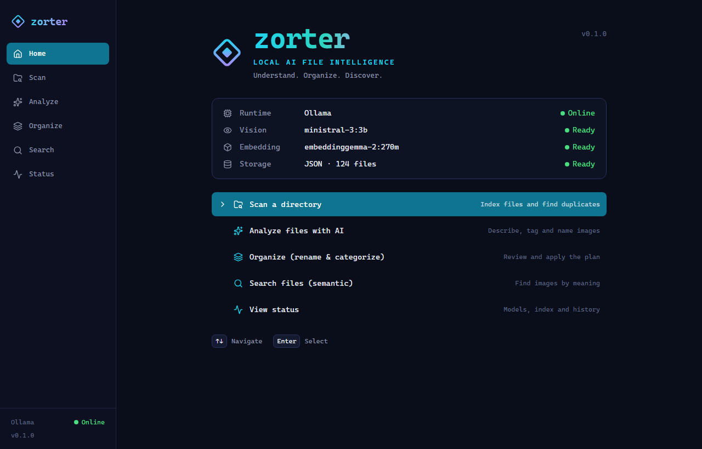
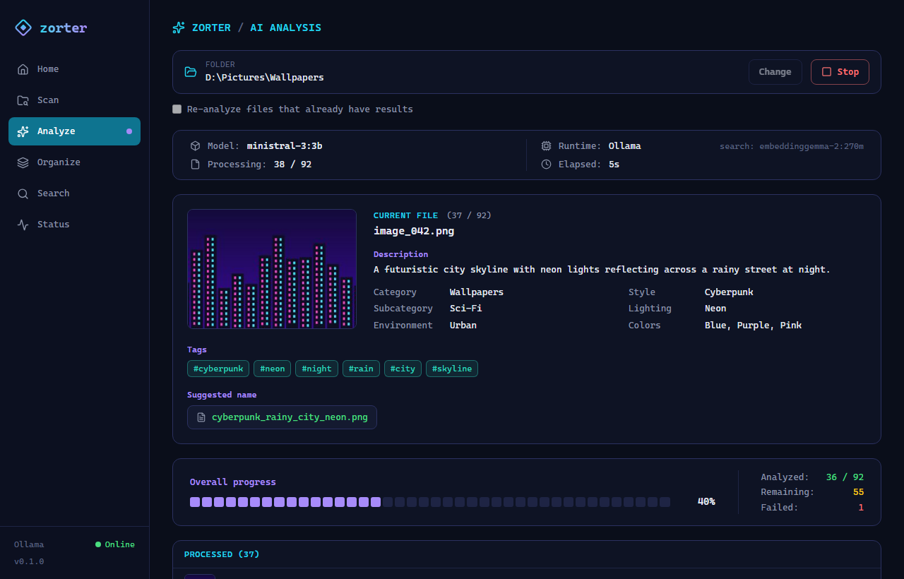
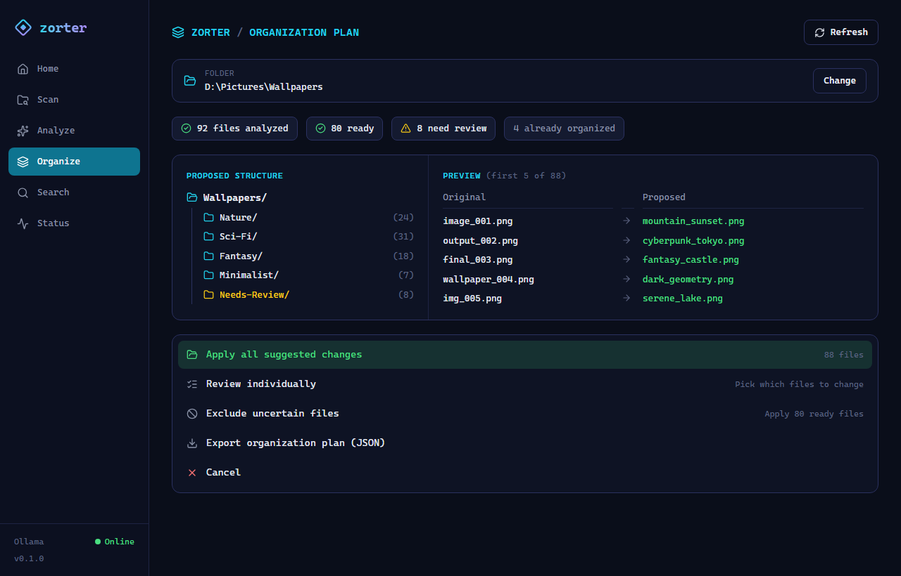
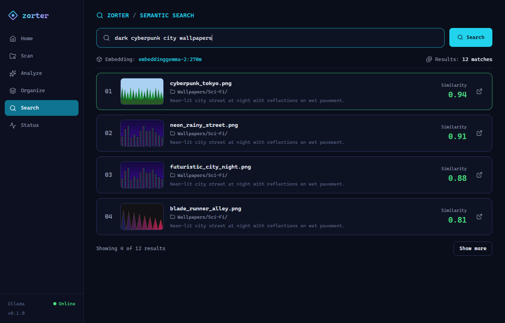

<div align="center">


# Zorter

**Local AI file intelligence — understand, organize and discover your images.**

Zorter looks at your pictures with a vision model running on your own machine, then
renames them, sorts them into folders and makes them searchable by meaning.
Nothing is uploaded anywhere.

</div>



## Features

- **Scan** a folder recursively: image / document counts, new vs. already indexed files, and exact duplicates (BLAKE3).
- **Analyze** every image with a local vision model — description, category, style, lighting, colors, tags and a clean suggested filename — with a live preview of each file. Stop at any time; finished results are kept and the next run resumes.
- **Organize** with a reviewable plan: proposed folder structure and renames, apply all / review file-by-file / exclude uncertain files, or export the plan as JSON. Moves never overwrite anything, a failure part-way rolls the whole batch back, and every organization can be undone.
- **Search** by meaning ("dark cyberpunk city wallpapers") using local embeddings, with keyword fallback when the search index isn't available.
- **Status** of the models, index, storage and operation history.

| AI analysis | Organization plan | Semantic search |
| --- | --- | --- |
|  |  |  |

## Requirements

- Windows 10 or 11 (64-bit). WebView2 is preinstalled on Windows 11; the installer fetches it on Windows 10 if needed.
- [Ollama](https://ollama.com) running locally, with the two models Zorter uses:

  ```bash
  ollama pull ministral-3:3b          # vision: describes and names images
  ollama pull embeddinggemma-2:270m   # embeddings: powers semantic search
  ```

  A GPU with 4 GB of VRAM is enough; images are downscaled to 768 px before analysis.

## Install

Download an installer from the [Releases](../../releases) page (or [build one](#build-the-installers)):

| File | Use it when |
| --- | --- |
| `Zorter_<version>_x64-setup.exe` | Recommended. Installs for your account only, no admin prompt. |
| `Zorter_<version>_x64_en-US.msi` | Installing machine-wide or deploying with Group Policy / Intune. |

Open **Zorter** from the Start menu. The usual flow is **Scan → Analyze → Organize**.

## How it works

```text
┌──────────────────────────── Zorter (one Tauri app) ────────────────────────────┐
│                                                                                │
│   React UI (WebView2)          Tauri IPC            Rust core                  │
│   Home · Scan · Analyze   ──── commands ────►   scan / analyze / organize      │
│   Organize · Search       ◄──── events ─────    search / undo                  │
│   Status                                              │                        │
│                                                       ├─► Filesystem: walk,    │
│                                                       │   BLAKE3, thumbnails,  │
│                                                       │   journaled moves      │
│                                                       ├─► Ollama HTTP API      │
│                                                       │   (vision + embeddings)│
│                                                       └─► JSON storage         │
└────────────────────────────────────────────────────────────────────────────────┘
```

- **Tauri** is the desktop shell: native window, the Rust backend, and the installers. The UI runs in the system WebView2, so the app is a few MB instead of bundling a browser.
- **React** renders the UI inside that window and talks to Rust through typed commands (`src/lib/api.ts` ↔ `src-tauri/src/commands/`). Long jobs stream progress back as events.
- **Ollama** does the AI work over its local HTTP API (`http://127.0.0.1:11434`).

### Data on disk

Everything lives in `%APPDATA%\zorter`:

| Path | Contents |
| --- | --- |
| `config/settings.json` | Models, naming convention, folder layout, Ollama endpoint |
| `index/files.json` | Indexed files with BLAKE3 hashes |
| `index/analysis.json` | AI descriptions and attributes |
| `index/embeddings/*.json` | Search vectors (500 per shard) |
| `history/operations.jsonl` | Append-only journal of every move, used by Undo |
| `cache/thumbnails/` | Small JPEG previews |

Settings has no screen; edit `settings.json` while Zorter is closed to change models or the endpoint.

## Development

Prerequisites: [Rust](https://rustup.rs) 1.90+, Node.js 20.19+ (or 22.12+), and the
[Tauri prerequisites for Windows](https://v2.tauri.app/start/prerequisites/) (MSVC build tools, WebView2).

```bash
npm install
npx tauri dev                                    # run with hot reload
cargo test --manifest-path src-tauri/Cargo.toml  # Rust tests
npx tsc -b && npm run lint                       # type-check and lint the UI
```

### Build the installers

```bash
npx tauri build
```

Output in `src-tauri/target/release/bundle/`:

- `nsis/Zorter_<version>_x64-setup.exe`
- `msi/Zorter_<version>_x64_en-US.msi`

The Tauri CLI downloads NSIS and WiX automatically on first build.

To change the app icon, edit `src-tauri/icons/app-icon.svg` and run `npx tauri icon src-tauri/icons/app-icon.svg`.

### Project layout

```text
src/                     React UI
  screens/               Home, Scan, Analyze, Organize, Search, Status
  components/            Shared UI (panels, badges, progress bars, thumbnails)
  lib/                   API bindings, types, app state, formatting
src-tauri/
  src/commands/          Tauri commands, one module per screen
  src/ai/                Ollama client, vision analysis, embeddings, prompts
  src/filesystem/        Scanning, hashing, thumbnails, journaled file operations
  src/organization/      Naming rules, folder planning, duplicates
  src/search/            Vector ranking and keyword fallback
  src/storage/           JSON repository with atomic writes and recovery
  tauri.conf.json        Window, security policy and installer settings
```
